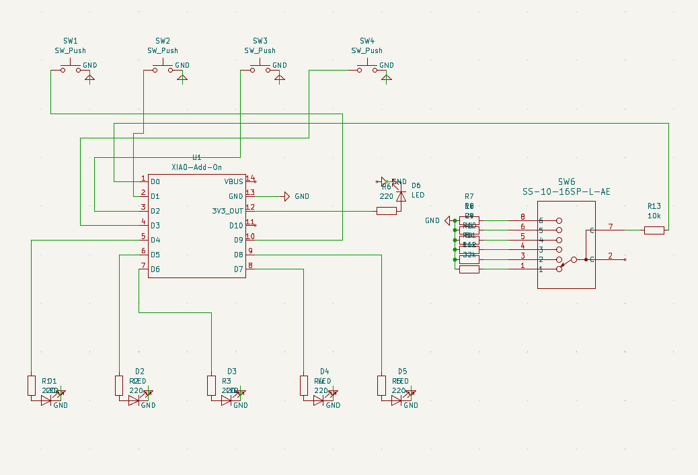
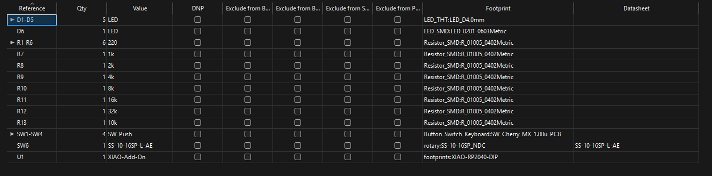

# My first PCB ever

## Table of contents

- [project description](#project-description)
- [project structure](#project-structure)
- [pins](#pins)
- [Bom](#bom)
- [case](#case)
- [shematic](#shematic)
- [gallery](#gallery)

---

## Project description

This is a figetoy style mini game board with space for up to 6 operating modes thanks to a 6 pos rotary switch. It features 4 keyboard switches for user interaction, 4 different colored leds corresponding to the 4 buttons and a sigular led for status messages (win, loose...) 

## Project structure

The repository and project is organized into themed folders:

folder | contents
--- | ---
`/screenshots` | various images of the project
`/pcb` | kicad source files
`/gerbers` | gerber files neccesary for pcb production
`/code` | code files
`/cad` | .3mf and source files for the 3d printable case
`/dancePad` | repository files

## pins

pin|designation
---|---
7|led left
6|led right
4|led top
5|led bottom
1|button left
3|button right
9|button top
2|button bottom
9|special led
0|6 position rotary (values WIP)

## Bom

## case

The case is fully 3d printable with the exeption of 4 3Mx6 screws.

 
 
 
 

## shematic

## gallery

